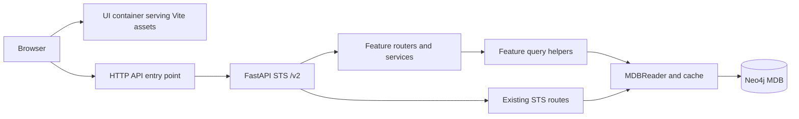

# MDB web application architecture

Status: draft, 2026-11-17. The frontend technology choices below are confirmed. Feature endpoints, module names, and data rules are defined by the selected work's spec and contract.

## Existing system

The repository contains the FastAPI Simple Terminology Service backed by Neo4j. The application mounts its routers under a package-major-version prefix, currently `/v2`. Existing routes expose models, versions, nodes, properties, terms, tags, entity IDs, and EDP information.

Evidence: [application](../../backend/src/bento_sts/sts.py), [MDB reader](../../backend/src/bento_sts/mdb.py), [response models](../../backend/src/bento_sts/pymodels.py), and [package metadata](../../backend/pyproject.toml).

The tracked frontend currently contains only an empty README. Untracked build output, dependencies, and generated configuration are present; they are not a reproducible frontend source baseline. Locate the intended source/branch or explicitly plan new frontend initialization before implementation.

## Confirmed technology choices

| Area | Choice |
| --- | --- |
| Language | TypeScript |
| UI | React |
| Build | Vite SPA |
| Design system | NCIDS/USWDS |
| API integration | TanStack Query and OpenAPI-derived types |
| Testing | Vitest and Playwright; backend pytest retained |
| Repository | Existing `frontend/` and `backend/` monorepo |
| CI/CD | Separate frontend and backend pipelines with path filters |
| Deployment | Separate UI and API containers; only the API connects to MDB |

NCIDS/USWDS supports the accessibility approach, but component adoption alone does not establish Section 508 conformance. Verify keyboard interaction, focus, accessible names, contrast, and relevant assistive-technology behavior.

## Proposed runtime architecture

TanStack Query runs in the browser and calls the HTTP API. The UI container serves assets and may proxy requests; it has no Neo4j driver or MDB credentials. Prefer a same-origin API proxy if deployment permits. Otherwise specify the allowed UI origins and CORS behavior. Exact proxy prefix, runtime configuration mechanism, and hosting target remain open.

### Frontend boundaries

- Routes compose feature components; reusable components follow NCIDS/USWDS.
- Feature hooks own query keys, loading/error state, request cancellation, and URL state synchronization.
- A transport client handles HTTP and typed error handling. OpenAPI-derived types must not be manually patched.
- Query keys include every input that affects the server response.
- UI-local state, such as a collapsed sidebar, remains separate from server query state.
- Keep related result data and metadata consistent during request transitions.
- Define URL-backed state and browser back/forward behavior in each feature contract.

### Backend boundaries

- Add feature routers, typed schemas, services, and query helpers within the existing backend as needed.
- Routers validate HTTP inputs and serialize responses. Services apply domain rules. Query helpers execute parameterized Cypher through MDBReader.
- Use bounded aggregate queries rather than per-item HTTP requests or query loops.
- Establish identity and distinctness rules before aggregating across graph joins.
- Preserve existing endpoint response shapes, count semantics, error behavior, and ordering unless a change is part of the feature contract.
- Retain FastAPI REST and Neo4j as the core architecture. Document the need and integration boundary for additional infrastructure.

## Data and cache policy

Neo4j remains the system of record. Figma example numbers and dates are not application data. `Model` currently exposes `name`, `handle`, `version`, `repository`, `is_latest_version`, and `nanoid`, but no release date or model-level statistics.

Resolve canonical identity and metadata provenance before mapping card fields. Some existing routes match model `name` while the model-PV route matches `handle`; do not silently equate them. Count model-defined relationships, not arbitrary internal MDB graph edges, once that definition is confirmed.

MDBReader has a process-local TTL cache with a default TTL of 28,800 seconds. Define acceptable freshness, refresh/invalidation behavior after model ingestion, and multi-worker consistency. Normalize multi-value filters into cache-compatible immutable values before passing parameters to the current reader; its key uses a tuple of parameter values. Do not change cache internals as incidental feature work.

## Search and navigation boundaries

For search features, assess the existing Bento-native capability and its contract before selecting an implementation. Existing `/terms` routes provide permissible-value lookups rather than global text search.

Each feature spec defines required navigation destinations and search behavior. Track unavailable destinations as integration work while allowing independent components and services to proceed.

## Local and CI verification

Use a dedicated local UI/API/Neo4j stack with deterministic fixture data. Core E2E requests pass through the real API and test database. Use interception only for separately identified fault-injection tests.

Separate component pipelines remain coupled at contract and integration boundaries:

| Change | Required verification direction |
| --- | --- |
| Frontend | Typecheck, Vitest, build, relevant browser tests |
| Backend | pytest, real Neo4j integration, OpenAPI compatibility assessment |
| API contract | Regenerate frontend types, typecheck consumer code, integrated E2E |
| Shared integration/deployment configuration | Both builds and integration checks |
| Documentation only | Reference, consistency, and scope checks |

Define CI commands and path filters from the recovered/initialized frontend and existing pipeline behavior.

## Delivery workflow

Select work by required inputs and affected layers. Backend and frontend tasks may proceed independently against a published contract with disjoint file ownership. Serialize shared configuration edits and stateful test runs. The coordinator owns integration and scope reconciliation; reviewer and QA findings return to the relevant producer.

Use an independent context for implementation review.

Use the [shared task workflow](../tasks/workflow.md) with the selected work's plan for inputs, applicable gates, and handoffs.

## Browse Models existing-API integration (2026-11-17)

The frontend fetches the complete `GET /v2/models/?include_counts=true` array.
The existing model-list router uses one batched Neo4j statement to read model
metadata and independently grouped entity counts. Its default request still uses
the original query and Model schema; no count field or aggregation cost is added.
`ModelWithCounts` extends Model only for the opt-in response.

`frontend/src/api/client.ts` adapts the inventory into cards, selects the current
version, applies name search/manual selection, sorts, computes filtered totals,
and then paginates. TanStack Query caches inventory separately from UI controls
with a 60-second stale time. The backend retains its existing configurable process
TTL (default 28,800 seconds; local preview uses 60). Separate query strings keep
legacy and aggregate snapshots in separate cache entries. This is not a shared
multi-worker cache or an immediate ingestion-invalidation mechanism.

Model detail continues to use the existing model/version node route after checking
existence and counts in the inventory. No database schema migration is required.
The dedicated model-card route and generated schema have been retired; repository
clients, QA scripts and CI now use the extended existing API.
